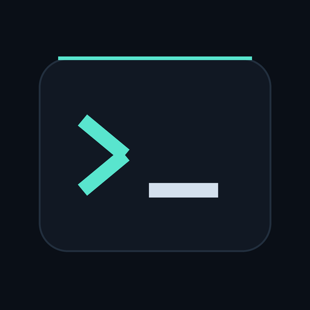
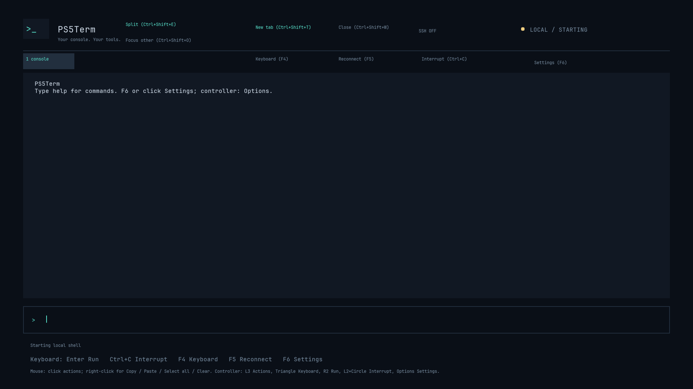
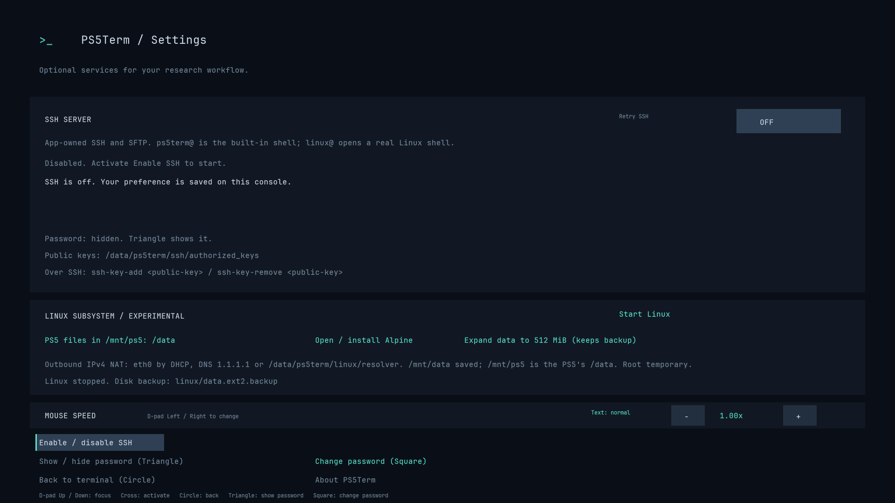
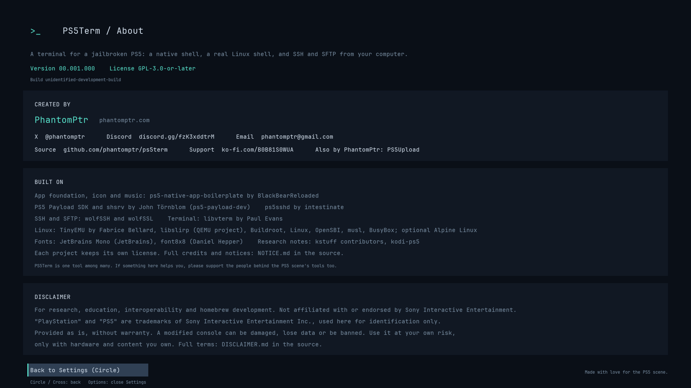

# PS5Term

<p align="center">
  
</p>

<p align="center">
  PS5Term is a terminal for a jailbroken PS5, right on the console's screen: a native
  shell for the PS5's own files, a real Linux shell with <code>curl</code>, <code>nano</code>,
  <code>tmux</code> and <code>htop</code>, and SSH and SFTP from your computer. Drive it with a
  keyboard, a mouse or a controller alone.
</p>

<p align="center">
  <a href="https://github.com/phantomptr/ps5term/releases"></a>
  <a href="LICENSE"></a>
  
  <a href="https://ps5term.phantomptr.com/"></a>
  <a href="https://discord.gg/fzK3xddtrM"></a>
</p>

---

## What it does

- **A native terminal** on the console's screen. Colours, Unicode and box drawing are
  drawn at native 1080p, with tabs, split panes, search, selection and copy/paste.
- **A built-in native shell** for the PS5's own files: `ls -alh`, `cat`, `cp`, `mv`,
  `grep`, `sha256sum`, `xxd`, pipes, redirects, `;`, `&&` and `||`. Type `help`.
  System commands: `ps`, `kill`, `uptime`, `free`, `nproc`, `sysinfo` and a read-only
  `sysctl`.
- **A real Linux shell**, inside the app: a RISC-V Linux 6.12 guest with BusyBox,
  `curl` with HTTPS, `nano`, `tmux`, `htop`, `jq` and `less`. Choose Start Linux
  in Settings, or just connect over SSH. Files in `/mnt/data` persist (16 MiB at first;
  expand to 512 MiB in Settings), `/mnt/ps5` shows the PS5's `/data` (or everything the
  app can see, if you choose that in Settings), and the optional Alpine environment and
  its `apk` packages persist inside `/mnt/data/alpine`.
- **SSH and SFTP** on port 2222, with the password shown in Settings or your own key:

  ```sh
  ssh -p 2222 linux@<PS5-IP>                # A real Linux shell; starts Linux if needed.
  command ssh -T -p 2222 ps5term@<PS5-IP>   # The built-in native shell.
  sftp -P 2222 ps5term@<PS5-IP>             # The PS5's own files.
  ```

- **Any input, alone.** A keyboard alone, a mouse alone, keyboard and mouse, or a
  controller alone: every action works with each, and on-screen hints name the keys
  of whatever you used last. See the [feature access matrix](docs/FEATURES.md).

## What it doesn't do

- The built-in shell is not a full POSIX shell: no other programs, job control or
  scripts. Use the `linux` login or Start Linux for that.
- Linux runs interpreted, so it suits shell work rather than heavy computation. Its
  outbound IPv4 network goes through the app, and nothing can connect in to it.
  Changes outside `/mnt/data` reset when Linux stops.
- CJK characters show a replacement mark.
- Firmware 13.60 on a phat console (CFI-1115A) is the only hardware tested so far.
  Reports from other firmware are welcome.

## A quick look

Host-rendered previews of the actual app scene (not console screenshots):

<p align="center">
  
  
  
</p>

## Install

Website: **[ps5term.phantomptr.com](https://ps5term.phantomptr.com/)**.

Download `PS5Term-<version>.zip` from the
[Releases page](https://github.com/phantomptr/ps5term/releases), copy the complete
`FAKE99260` folder to `/data/homebrew/FAKE99260` on the console, and launch it with your
homebrew launcher. A compatible jailbreak and native app loader are required. The app
owns its SSH/SFTP server and needs no separately sent payload or ELF loader.

## Quick start

1. Open PS5Term. The built-in shell is ready; type `help`.
2. Open Settings (Options on the controller, Ctrl+Shift+S on a keyboard, or the
   Settings button) and choose **Enable / disable SSH**. SSH is off by default and the
   choice is saved on the console. Settings shows the connection command and the
   password, and can change it.
3. Choose **Start Linux** in Settings for a real Linux shell, or connect with
   `ssh -p 2222 linux@<PS5-IP>`.

Ghostty works with its default SSH features. In Warp, use `command ssh` for the
`ps5term` login (see [terminal client compatibility](docs/TERMINAL_CLIENTS.md)). See
[SSH setup and validation](docs/OWNED_SSH.md) and
[controls and limitations of Linux](docs/SUBSYSTEM.md).

## Controls

Keyboard: Shift+F10 (or the Menu key) opens the actions menu. Ctrl+Shift+S opens
Settings, Ctrl+Shift+K the on-screen keyboard, Ctrl+Shift+Space selects text and
Ctrl+Shift+1-4 shows a tab; these work everywhere. In a Linux program every F-key,
F1-F12, goes to the program; in the built-in shell F4 is the keyboard, F5 reconnects
and F6 opens Settings. Settings follows the screen with Tab/Shift+Tab or Up/Down, and
F1 there opens About.

Controller:

- Triangle opens or closes the keyboard; D-pad selects a key; Cross types it. Its
  last two rows have Esc, Tab, Ctrl, Alt, arrows, PgUp, PgDn, Home, End, F1-F10, Del
  and Ins. Ctrl and Alt apply to the next key; R3 Shift also shifts terminal keys
  (Shift+Tab).
- R2 sends Enter. With the keyboard closed, Cross runs entered text or opens
  the keyboard for an empty line. Cross retries when shell startup has failed.
- Square deletes; R3 switches case; L1/R1 are Up and Down, which browse history.
- Circle closes the keyboard. Otherwise it cancels entered text in the built-in shell
  and sends Esc in Linux. L2 + Circle interrupts. D-pad scrolls output while the
  keyboard is closed; in a full-screen program it sends the arrows.
- Options opens Settings. Cross toggles SSH, Triangle shows/hides the password,
  Square changes the password, Circle goes back.

Mouse: click any button or key, drag to select, right-click for the actions menu,
middle-click to paste, and the wheel scrolls.

## Build and test

```sh
make release
```

Build on Linux. Output: `dist/FAKE99260/` and `dist/PS5Term-<version>.zip`. The
release build, its definitions and the checks to run first are in
[releasing](docs/RELEASE.md); see also [testing](docs/TESTING.md) and
[getting started](docs/GETTING_STARTED.md).

The renderer uses bundled antialiased JetBrains Mono at native 1920x1080, with 16 px
body text, 172 columns and 29 rows. It includes accented Latin, Greek, Cyrillic,
arrows and Powerline symbols; box and block characters are drawn to fill their cells.
Regenerate the atlas with Pillow 12.0.0 and `tools/generate-font-atlas.py`. No console
font dependency is required. The optional Bash 5.3.20 SDK link audit and Linux shell
smoke suite are documented in [BASH_PORT.md](docs/BASH_PORT.md); Bash is not an
installed native session backend. Development boundaries and retired legacy components
are in [development scope](docs/DEVELOPMENT_SCOPE.md).

## Disclaimer

> **PS5Term is provided for research, educational, interoperability, and homebrew
> development purposes only.** It is not affiliated with, endorsed by, or connected to
> Sony Interactive Entertainment Inc. "PlayStation" and "PS5" are trademarks of Sony
> Interactive Entertainment Inc., used here for identification only.
>
> **Use this software entirely at your own risk.** It is provided "as is", without
> warranty of any kind, express or implied, including but not limited to warranties of
> merchantability, fitness for a particular purpose, and non-infringement.

**➡ Full terms: [DISCLAIMER.md](DISCLAIMER.md).** By downloading, building, installing,
or using this software you accept them in full. If you do not agree, do not use it.

- **It runs commands on a modified PS5** with the app's permissions. A mistaken command
  can delete or corrupt data the app can reach. Back up anything you cannot afford to
  lose before you begin.
- **SSH opens port 2222 on your network.** Anyone who can reach it with the password or
  an authorised key can run commands and transfer files. Keep it on a network you
  trust, and switch it off when you don't need it.
- **No piracy.** It must not be used to copy, distribute, or run software you do not
  lawfully own or are licensed to use.
- **No support is guaranteed.** This is a free, volunteer-built tool.

## Credits

PS5Term builds on other people's work. Each entry says how: **included** (their source
is in this repository or built into the app), **derived** (their code adapted into
PS5Term), **library** (a dependency the build pulls in), **fetched on request**
(downloaded from its own home when you use the feature; not shipped with PS5Term), or
**reference** (read to learn how something works; no code taken). Full notices are in
[NOTICE.md](NOTICE.md).

**Included:**
* [libvterm](https://www.leonerd.org.uk/code/libvterm/) (Paul Evans): the terminal
  emulation, in [`third_party/libvterm`](third_party/libvterm)
* [wolfSSH](https://github.com/wolfSSL/wolfssh) and [wolfSSL](https://github.com/wolfSSL/wolfssl)
  (wolfSSL Inc.): the SSH and SFTP server and its cryptography, built from verified
  source archives with PS5Term's patches
* [TinyEMU](https://bellard.org/tinyemu/) (Fabrice Bellard): the RISC-V machine that
  runs Linux, in [`third_party/tinyemu`](third_party/tinyemu)
* [libslirp](https://gitlab.freedesktop.org/slirp/libslirp) (the QEMU project and
  contributors): the Linux guest's network, in [`third_party/libslirp`](third_party/libslirp)
* The Linux guest, built with [Buildroot](https://buildroot.org/):
  [Linux](https://kernel.org/), [OpenSBI](https://github.com/riscv-software-src/opensbi),
  [musl](https://musl.libc.org/), [BusyBox](https://busybox.net/),
  [ncurses](https://invisible-island.net/ncurses/), curl, Mbed TLS, nano, tmux, htop,
  jq, less, tree and e2fsprogs
* [JetBrains Mono](https://www.jetbrains.com/lp/mono/) (JetBrains): the terminal font,
  in [`third_party/jetbrains-mono`](third_party/jetbrains-mono)
* [font8x8](https://github.com/dhepper/font8x8) (Daniel Hepper): the public-domain
  bitmap font, in [`third_party/font8x8`](third_party/font8x8)
* The icon, selection artwork and the music track "Night Drive" by BlackBearReloaded

**Derived:**
* ps5-native-app-boilerplate (BlackBearReloaded):
  the native app foundation
* [shsrv](https://github.com/ps5-payload-dev/shsrv) (John Törnblom): the local command
  backend, in [`third_party/shsrv`](third_party/shsrv)
* [ps5sshd](https://github.com/intestinate/ps5sshd) (intestinate): the legacy SSH
  service, in [`third_party/ps5sshd`](third_party/ps5sshd)

**Libraries:**
* [PS5 Payload SDK](https://github.com/ps5-payload-dev/sdk) (John Törnblom), with its
  LLVM libc++ headers, and [zlib](https://zlib.net/)
* [GoogleTest](https://github.com/google/googletest) for host tests only

**Fetched on request:**
* [Alpine Linux](https://www.alpinelinux.org/) minirootfs and the `apk` packages you
  install
* Optional packaging tools: [UFS2Tool](https://github.com/SvenGDK/UFS2Tool) (SvenGDK),
  [MkPFS](https://github.com/PSBrew/MkPFS) (PSBrew) and
  [PacBrew](https://github.com/ps5-payload-dev/pacbrew-repo) ports
* [GNU Bash](https://www.gnu.org/software/bash/) for the optional, uninstalled Bash port

**References:**
* [kstuff-lite](https://github.com/EchoStretch/kstuff-lite) (EchoStretch and the kstuff
  contributors): the native-executable capability record for one research profile
* [kodi-ps5](https://github.com/Phoenixx1202/kodi-ps5) (Phoenixx1202 and contributors):
  the native directory buffer requirement
* SharpProspero: the PS5 ELF format, while writing PS5Term's own converter
* [OpenOrbis](https://github.com/OpenOrbis/OpenOrbis-PS4-Toolchain): the public
  libkernel mapping declarations

PS5Term is one tool among many. The PS5 scene is full of great work: loaders, kernel
patches, payloads, file managers and more. If something here saves you time, the people
behind those tools deserve the same thanks. Please support them too.

## License

PS5Term is free software under the GNU General Public License v3.0 or later; see
[LICENSE](LICENSE). Included third-party code keeps its own license, next to the code or
in the app's `licenses` folders; see [Credits](#credits) and [NOTICE.md](NOTICE.md).
Corresponding source for the Linux guest is described in [SUBSYSTEM.md](docs/SUBSYSTEM.md).

## Author

Created and maintained by **PhantomPtr** ([phantomptr.com](https://phantomptr.com/)).
PS5Term's website: [ps5term.phantomptr.com](https://ps5term.phantomptr.com/).

* [Follow me on X (@phantomptr)](https://x.com/phantomptr)
* Also by PhantomPtr: [PS5Upload](https://github.com/phantomptr/ps5upload), which sends
  games, apps and homebrew to a jailbroken PS5 (and can install PS5Term).

## Support

If you find this tool useful, consider buying me a coffee!

* Discord server: [https://discord.gg/fzK3xddtrM](https://discord.gg/fzK3xddtrM)
* Support me on Ko-fi: [https://ko-fi.com/B0B81S0WUA](https://ko-fi.com/B0B81S0WUA)

[](https://ko-fi.com/B0B81S0WUA)

**Crypto**, straight to my hardware wallet. Send each coin only on its own network;
anything else can't be recovered.

| Coin | Network | Address |
| --- | --- | --- |
| BTC | Bitcoin | `bc1q36gxkvd3wfxy9azm8hft3rru9m6m9hjvn7u20n` |
| ETH | Ethereum | `0x2e787654db543B69FB011E16995C274dFAfc2286` |
| SOL | Solana | `G1q5XCCn3mePYpcx7uY17CwDsUaAZTcty56huUDvVqjG` |
| XRP | XRP Ledger | `rEVq3si3sm9NuWNuZiUZFKsUtwC3w9SrjR` (no destination tag needed) |

QR codes for each are on [the PS5Upload website](https://ps5upload.phantomptr.com/#thanks).

### Thank you

Thank you to everyone who supports PS5Term and PS5Upload. Every coffee keeps them going.
