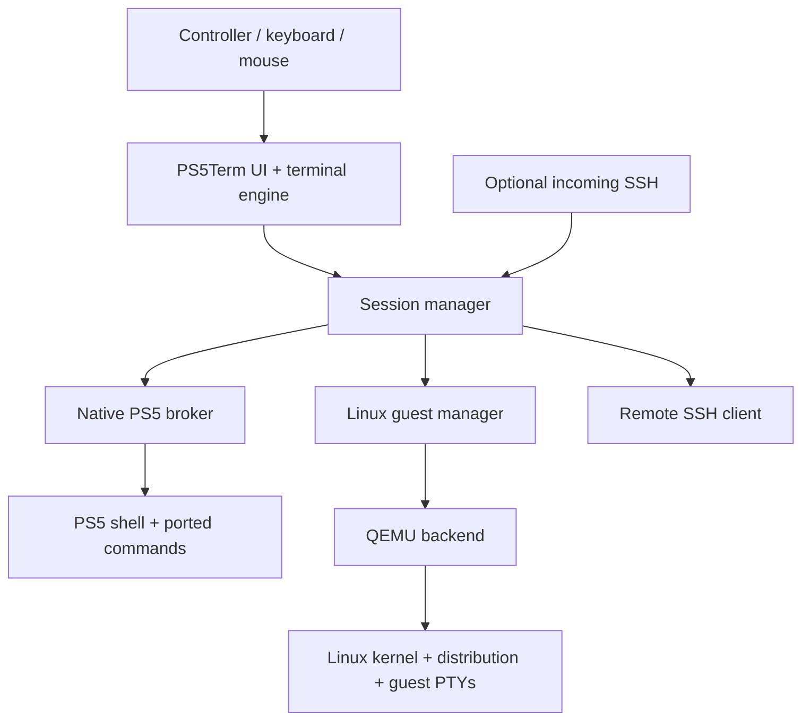

# PS5Term: platform research and proposed subsystem design

> Historical research snapshot, not a current feature or deployment guide.
> Start with [development scope](../DEVELOPMENT_SCOPE.md) and
> [current feature access](../FEATURES.md); retain the dated evidence below.

Research date: 2026-11-01. **Proposal, not an approved implementation plan.**

Scope: read-only application/source inspection and public primary-source research. Keyboard and mouse capabilities are assumed available and belong to the other agent. No application code, console state, build outputs, running services, or input implementation were changed for this investigation. No upstream Linux or VM release was executed on a console.

## Recommendation

Build one terminal application with independent session backends:

1. **Native PS5** for examining and working with the currently running console.
2. **Linux guest** for a complete, conventional server userspace and real Linux kernel, while PS5 OS remains running. First investigate software system emulation; hardware acceleration is a separate, unproven project.
3. **Remote SSH** for development machines and other servers.

Keep **booting Linux directly on the PS5** as a separate option. It offers much better performance potential and current upstream claims firmware 13.60 support, but changes the operating system running on the hardware. It cannot provide simultaneous access to a live PS5 kernel through a native terminal session.

Do not begin by writing a Linux syscall compatibility layer, a new hypervisor, or a PS5 hardware emulator. Those would dominate the project before the terminal becomes useful.

## 1. What the PS5 actually runs

Andy Nguyen's RomHack 2024 presentation identifies PS5 as AMD Zen 2 hardware with a **heavily modified FreeBSD 11-derived system**, including custom syscalls and drivers. This is ancestry, not a promise that a FreeBSD distribution's binaries or administration tools work unchanged. [Primary presentation](https://romhack.io/wp-content/uploads/2024/10/Andy-Nguyen-PlayStation-4-Remote-Kernel-Exploitation-RomHack-2024.pdf)

Three compatibility boundaries matter independently:

| Boundary | What matching it gives us | What remains |
| --- | --- | --- |
| CPU instruction set: x86-64 | Suitable machine instructions | Executable loading, kernel APIs, libraries |
| Kernel ABI | Expected syscall behavior and structures | Userspace libraries and runtime |
| Loader/library ABI | Process startup, symbols, dynamic linking | Devices, permissions, firmware-specific behavior |

An Ubuntu amd64 binary matches the CPU but expects Linux syscalls and a Linux loader/libc. A FreeBSD amd64 binary is closer historically, but can still depend on absent or changed syscalls, device interfaces, ELF loading, or libraries. Statically linking removes some library dependencies, not the kernel ABI dependency.

### Jailbreak capabilities are a measured matrix

Depending on the exploit chain, process credentials, sandbox state, loader and firmware, homebrew can gain executable loading, broader filesystem access, networking, process introspection, debugging and kernel-memory access. Hypervisor defeat can remove additional restrictions and enable deeper research or an alternative OS boot path. It does **not** install missing POSIX interfaces, provide Sony driver sources, expose a ready-made virtualization API, or prove every secure processor is under application control.

Keep these facts distinct in the app: effective UID, platform capabilities/authentication identity, sandbox context, kernel access, and any separately verified hypervisor capability. Displaying `root` alone would conceal important limitations.

Do not promise an exhaustive command/capability list from the jailbreak label. Record capabilities for the exact firmware, model, process type and launcher used. Native application and privileged helper may have different results.

## 2. What our code currently provides

This is a moving working tree shared with another agent; these are inspected structures, not a fresh hardware-validation claim.

| Inspected area | Current implementation | Design implication |
| --- | --- | --- |
| `src/terminal.hpp`, `src/terminal.cpp` | Fixed 108-column, 512-line buffer; byte characters; limited escape handling | Replace or wrap with a real terminal state engine before promising full-screen Unix applications |
| `backend/ps5term_parse.h` | Bounded single-command parsing; rejects pipes, redirects, command separators and background operators | Current prompt is not a POSIX shell |
| `third_party/shsrv/sh.c` | Pipe-based command execution through the payload loader | Interactive terminal semantics and ordinary process spawning remain separate problems |
| `src/connection.cpp` | Loopback shell connection on 2324; startup through external elfldr on 9021 | Bundling helper files does not yet make startup independent of another service |
| `src/ssh_service.hpp`, `tools/prepare-ssh.py` | Bundled server built from vendored ps5sshd with project patches | Own the service integration and configuration; keep upstream provenance explicit |
| Input/pointer/research modules | Active work by the other agent | Treat available input events as a frontend boundary; do not redesign their implementation here |

The SDK exposes declarations such as `fork`, `execve`, `openpty` and `forkpty`. Headers demonstrate a compile-time API surface; runtime support must be measured. The local SDK headers are under `/opt/ps5-payload-sdk/target/include`.

The foundation gap is **PTY + process lifecycle + shell + VT behavior**, not simply adding more command names. `vim`, `less`, `top`, `tmux` and interactive SSH depend on combinations of raw input, terminal modes, cursor addressing, resize, signals and process groups.

## 3. Ways to obtain a complete environment

| Approach | Complete kernel/userspace? | PS5 OS stays running? | Assessment |
| --- | --- | --- | --- |
| Native PS5 tool collection | Selected userspace; existing Sony kernel | Yes | Essential for console research; most immediately useful |
| FreeBSD rootfs in chroot/jail | Files/userspace only; shares host kernel | Yes | Cannot repair missing kernel APIs; compatibility experiment only |
| Linux syscall translation | Potentially broad Linux userspace; translated kernel APIs | Yes | Long-term kernel/loader project; high maintenance |
| QEMU system emulation | Real guest kernel plus chosen userspace | Yes, subject to app resources/lifecycle | Best initial path to test an in-app subsystem |
| Hardware-accelerated guest | Real guest kernel plus chosen userspace | Potentially | Requires a PS5-specific virtualization backend; not established |
| Boot Linux on hardware | Real Linux kernel and distribution | No | Existing upstream path; separate hardware experiment |
| SSH to external Linux/FreeBSD | Complete remote environment | Yes | Useful early feature and development aid; compute is remote |

### Why chroot, jails and Linuxulator are different

`chroot` changes filesystem lookup. A jail adds isolation using the host kernel. Neither supplies another kernel. Standard FreeBSD's Linuxulator has actual kernel compatibility components; copying its rootfs or its kernel module into a Sony-derived system does not establish compatibility. [FreeBSD jails](https://docs.freebsd.org/en/books/handbook/jails/), [Linux compatibility](https://docs.freebsd.org/en/books/handbook/linuxemu/)

Likewise, PRoot relies on Linux tracing interfaces, and QEMU user-mode emulation expects particular host operating-system facilities. Neither is an automatic Linux-on-PS5 solution. [PRoot](https://proot-me.github.io/), [QEMU user mode](https://www.qemu.org/docs/master/user/main.html)

### The WSL analogy

WSL 1 translates system calls; WSL 2 runs a real Linux kernel in a managed VM. The second architecture is the better product analogy for a complete PS5Term environment. Our initial accelerator would likely be software emulation, so performance must not be equated with WSL 2. [Microsoft architecture comparison](https://learn.microsoft.com/en-us/windows/wsl/compare-versions)

FreeBSD's bhyve needs host virtualization facilities, including its VMM support. PS5 heritage and hypervisor defeat do not make those facilities available automatically. QEMU's documented accelerators also do not include a PS5 backend. A new backend would need execution control, memory mapping, interrupt/timer handling and guest/host coordination. [FreeBSD virtualization](https://docs.freebsd.org/en/books/handbook/virtualization/), [QEMU accelerators](https://www.qemu.org/docs/master/system/introduction.html)

### Relevant existing Linux work

**Native Linux boot:** upstream `ps5-linux-loader` README at commit `e7954b27ddc27b03ddbb6f49fb94100b0d1f271e` lists **13.60** for Phat/Slim and Pro. This was verified against the pinned raw README; search snippets were older. It describes a rest-mode transition, USB storage and incompatibility with enabled etaHEN/kstuff. Treat compatibility as an upstream claim pending validation on the exact target console. [Pinned loader README](https://github.com/ps5-linux/ps5-linux-loader/blob/e7954b27ddc27b03ddbb6f49fb94100b0d1f271e/README.md)

The project supplies a distribution image builder and PS5 kernel patches. Current image-builder options include Ubuntu 26.04, Arch, CachyOS and Fedora; these are useful for a separate hardware-Linux track, not guest images that should be copied blindly into PS5Term. [Image builder](https://github.com/ps5-linux/ps5-linux-image), [Kernel patch set](https://github.com/ps5-linux/ps5-linux-patches)

**In-app Linux precedent:** LPS5 published a TinycoreApp release with a source archive. I downloaded and inspected source files without executing them. The archive contains QEMU 10.2.0 port code, a TCG-interpreter configuration and a separate experimental native-TCG configuration. Both inspected configurations disable slirp; the inspected `pc-launch.c` selects single-threaded TCG, `-nic none`, ISO boot and serial-log output. The build script itself explicitly makes no deployment or boot claim. This is evidence of relevant porting work, not proof that a reproducible, networked Linux server is ready. [Release and source assets](https://github.com/samuelww043-cpu/LPS5/releases/tag/Ps5complied)

Archive fingerprint: `TinyCore-Sources.zip`, SHA-256 `b83428795b1f1f74d20461bb11c3d4c4ac431dc6a4ac5cff993db51de87afea2`. Key inspected members: `vm64-work/build-native-tcg.sh`, `configure-pc-backend.sh`, `pc-port/pc-launch.c`, `pc-port/pc-crt.cpp`. Some bundled notices concern other projects, so attribution and dependency provenance need reconciliation before reuse.

## 4. Proposed app architecture

The session interface should carry byte streams, terminal dimensions, lifecycle events, exit status and explicitly supported control operations. Backend-specific functionality must remain visible: a pipe session cannot silently claim PTY capabilities.

The native broker owns launching, credentials, process trees and session cleanup. The guest manager owns RAM limits, disks, boot logs, shutdown and guest connections. Frontend failures should not corrupt disks or leave unmanaged server processes.

Use a serial console for the first guest boot. Add multiple guest sessions through a guest agent or authenticated loopback connection later. Guest-to-host operations should use a narrow, deliberate bridge; a full Linux guest does not automatically gain access to PS5 processes, devices or kernel memory. Guest `root` and host `root` are separate identities.

### Standalone ownership

PS5Term should own `/data/ps5term` configuration, host keys, credentials, logs and service lifecycle. Proposed directories: `config/`, `ssh/`, `bin/`, `lib/`, `packages/`, `guests/`, `logs/`, `research/`. Keep writable data separate from `/app0` application assets. These are proposed paths, not a migration performed by this document.

A standalone release should start its own required backend without requiring users to manage a separately running ps5sshd or elfldr service. Whether an embedded launcher or another process model is viable requires a firmware-specific proof. Reusing maintained SSH protocol/cryptography libraries is compatible with owning the product; rewriting cryptography is unnecessary. Preserve upstream attribution and distribution obligations.

## 5. Terminal projects worth learning from

| Project | Relevant ideas | PS5Term adaptation |
| --- | --- | --- |
| [Ghostty](https://ghostty.org/docs/about) | Strong terminal core and native integration | Separate VT state from PS5 rendering and platform code |
| [WezTerm](https://wezterm.org/features.html) | Multiplexing, SSH, workspaces, quick selection | Named local/guest/remote sessions; reconnectable workflows |
| [kitty](https://sw.kovidgoyal.net/kitty/overview/) | Keyboard workflow, layouts, extensibility | Good keyboard defaults and optional later graphics support |
| [iTerm2](https://iterm2.com/features.html) | Search, panes, history, shell integration | Searchable scrollback, persistent profiles and clear job status |
| [Windows Terminal](https://github.com/microsoft/terminal) | Multiple environment profiles and panes | Native PS5 and Linux sessions share the same frontend |
| [Warp](https://docs.warp.dev/terminal/blocks) | Structured command/output blocks | Controller-friendly command history and reusable command cards |
| [Termux](https://github.com/termux/termux-packages) | App-owned prefix and package recipes | Reproducible PS5 package ecosystem, independent of host system directories |
| [PSXTERM](https://github.com/seregonwar/PSXTERM) | PS4/PS5 session protocol and native-tool execution | Compare PTY/fallback design and hardware-bringup evidence; not a full distribution |

Do not port a desktop terminal's complete windowing stack. A portable terminal engine embedded in our frontend is a smaller first step. **libvterm** is a C99 callback-driven VT implementation with no required GUI toolkit. Benchmark it first. **libghostty-vt** is another candidate, but its public header currently labels the API incomplete and unstable; pin a revision for an isolated evaluation. [libvterm upstream](https://www.leonerd.org.uk/code/libvterm/), [libghostty-vt header](https://github.com/ghostty-org/ghostty/blob/main/include/ghostty/vt.h)

### Product priorities

First: correct terminal behavior, resize, Unicode handling, alternate screen, scrollback/search, copy/paste, persistent history, configurable font size, session status and discoverable controls. Advertise a `TERM` value only after matching its capabilities.

Then: tabs, profiles, split panes, saved connections, bookmarks, file transfers and session reattachment. Controller actions should operate app navigation without stealing arbitrary shortcuts from terminal applications; keep escape/control sequences available through a command palette. Input transport itself belongs to the other agent.

Settings should retain connection details visibly: SSH state, address, port, username, authentication method, host-key fingerprint and explicit credential management. Use persistent status instead of short-lived notifications for information users must type on another machine.

Later: command blocks, snippets and a research workspace showing model, firmware and measured capabilities. Enable richer command blocks when shell integration can reliably identify command boundaries; do not infer them from arbitrary output.

## 6. Packages: build an ecosystem without porting everything first

BusyBox is a collection of programs, not a replacement kernel. Linux-oriented applets may require Linux-specific interfaces. Toybox also has platform-specific coverage. Evaluate a PS5 subset or selected FreeBSD utility sources for native tools; use ordinary distribution BusyBox/packages inside a Linux guest. [BusyBox FAQ](https://busybox.net/FAQ.html), [Toybox portability discussion](https://www.landley.net/toybox/faq.html)

PacBrew already provides many PS5 build recipes, including networking, compression, language runtimes and graphics libraries. Reuse the recipes and inspect build options; a library recipe is not proof that its command-line tool or all features run on the console. Snapshot inspected: `722187f0ee246c0d7d57401c8a97de1c7f4e2ff0`. [PacBrew repository](https://github.com/ps5-payload-dev/pacbrew-repo)

| Package group | Native PS5 route | Linux guest route |
| --- | --- | --- |
| `ls`, `cat`, `cp`, `mv`, `rm`, `mkdir`, `find`, text tools | Small source ports; validate paths, metadata and errors | Distribution packages |
| Shell, pipes, redirects, jobs | Port a maintained shell after process/PTY investigation | Standard shell and guest PTYs |
| `curl`, archives, hashes, TLS | Reuse suitable SDK/PacBrew libraries and build CLI frontends | Distribution packages |
| Lua, Python, SQLite, Git | Progressively validate libc/process/network requirements | Distribution packages, subject to guest resources |
| `ps`, `top`, mounts, tracing, debugger | PS5-specific kernel/device adaptation | Describes the guest, not the PS5 host |
| systemd, containers, Linux networking | Require substantial missing kernel facilities | Depend on chosen guest kernel/configuration; not automatic |
| Compiler/toolchain | Cross-build on Mac/CI first; native compiler later | Possible but software-emulated compilation may be slow |

Native packages need manifests containing version, source revision/hash, license, build recipe, required capabilities, dependencies, installed paths and supported/verified firmware. Use staged installs and recoverable updates within the app prefix. Never mix generic FreeBSD binary repositories into the PS5 prefix. Guest packages remain managed by their distribution.

## 7. Development lab on this Mac

This machine reports **arm64 and 64 GiB RAM**. No VMs were installed or started for this research.

| Environment | Purpose | Initial allocation proposal |
| --- | --- | --- |
| Existing macOS/ARM64 cross-build tools | Native PS5 app and package builds | Use existing setup |
| ARM64 Linux VM | Fast Linux tooling, reproducible builds and guest-image assembly | 4–8 vCPUs, 8 GiB RAM |
| amd64 FreeBSD VM, software emulated | Reference syscall, PTY and utility behavior | 2–4 GiB RAM; on demand |
| amd64 Linux system guest | Validate the same headless guest image/device model intended for PS5 | 512 MiB–2 GiB RAM initially |

These are starting host-lab budgets, not proven PS5 app limits. Apple Silicon hardware virtualization accelerates ARM guests; amd64 guests need emulation. A FreeBSD VM is an ABI/reference environment, not an emulator of Sony's kernel. Cross-compilation need not run inside an amd64 VM for every package. [UTM QEMU configuration](https://docs.getutm.app/settings-qemu/system/)

Share terminal test recordings and guest images across host and console testing. Host CI can verify parsing, package recipes, terminal behavior and generic Linux boot. Only the physical console can validate Sony APIs, process privileges, launch behavior, app memory limits and suspend/termination behavior.

## 8. Should we dump and emulate the PS5 kernel?

**A targeted dump can help answer specific compatibility questions. It is not the prerequisite for the terminal or guest project.** Useful questions include syscall dispatch, PTY availability, process restrictions and differences from upstream FreeBSD. Keep dumps private and record model, firmware, address ranges, unreadable holes and hashes.

A kernel image is not a bootable PS5 VM. Reproducing execution can require boot state, memory mappings, device models, interrupts, storage and custom SoC/security-processor behavior. A memory snapshot also needs compatible machine state. Patching or disassembling a dump is different from faithfully running it.

Existing PS4/PS5 emulation projects must be judged by the specific use case. RPCSX describes itself as experimental game emulation; its existence does not establish a firmware-13.60 kernel laboratory suitable for validating our syscalls. No such faithful target was verified in this research. [RPCSX FAQ](https://rpcsx.github.io/wiki/faq/)

Use the cheapest evidence source for each question: host tests for VT/rendering, a normal FreeBSD VM for reference behavior, a Linux VM for guest packaging, and small physical-console probes for Sony-specific behavior. Dump or reverse engineer only when a concrete missing capability blocks progress.

## 9. Proposed investigation order and decision gates

### A. Native capability inventory

Measure in both native app and helper contexts: credentials; writable paths; ordinary spawn/fork/exec behavior; pipes; PTY allocation; termios/ioctl; signals, process groups and resize; poll/kqueue; threading; executable mappings; clocks; DNS; resource limits. Record failures as well as successes. Start with read-only or short-lived probes; do not test kernel mutations as a generic capability sweep.

Success: enough measured evidence to choose a real shell/process model and state honestly whether native interactive applications can work. A missing PTY may require a userspace terminal broker and adaptation; pipes alone are not an equivalent replacement.

### B. Terminal/session foundation

Evaluate libvterm, define backend contracts, and exercise alternate screens, cursor movement, colors, resize, Unicode and control keys using recorded streams. Prove a native interactive session on hardware before claiming compatibility with full-screen tools. Keep existing input work independent.

### C. Standalone native environment

Own service/configuration paths and launcher lifecycle; port a small useful tool set; package it reproducibly. Success means launching PS5Term without separately managing its shell or SSH application, with documented jailbreak prerequisites. This requires implementation work beyond this research.

### D. Linux guest feasibility spike

First audit/reproduce the existing QEMU port in a separate scratch area. Boot a tiny known Linux kernel/initramfs to serial; then persistent disk; then sockets/user-mode networking; then a package-managed headless distribution. Add network support explicitly—the inspected prototype lacks it. Consider a minimal Alpine guest first, Debian/Ubuntu when resources and compatibility justify them.

Measure boot time, idle/working RAM, command latency, sustained CPU throughput, file I/O, network throughput, disk recovery, orderly shutdown and forced-app-close behavior. Test both interpreter and native TCG only where executable-memory support is established. Do not claim usability from a boot screenshot. Set product limits from measurements, not the console's total installed RAM.

Success: an installable package, interactive shell, persistence after clean restart, working network and acceptable responsiveness inside the homebrew app. If performance is poor, retain a clearly experimental backend and prioritize native tools, remote sessions or hardware Linux rather than promising a fast subsystem.

### E. Separate hardware-Linux evaluation

Review the pinned loader, exact model/firmware and exploit prerequisites; prepare an external image in the lab. A console boot test interrupts the PS5 runtime and should be scheduled separately from the other agent's app tests. It was not attempted here.

## Open decisions

- How much guest responsiveness is acceptable for package management and development? Benchmark before setting promises.
- Can the exact homebrew process obtain reliable PTY/spawn behavior and executable-memory support?
- What memory and lifecycle limits apply to this title on 13.60?
- Can the existing QEMU source release be rebuilt with a coherent provenance trail and minimal dependencies?
- Which native launch design removes the external 9021 service requirement without making unsupported firmware assumptions?

Working product assumption: **PS5Term remains a native homebrew app; native PS5 access is always useful; an optional Linux server guest expands the software ecosystem without redefining guest tools as host research tools.**
