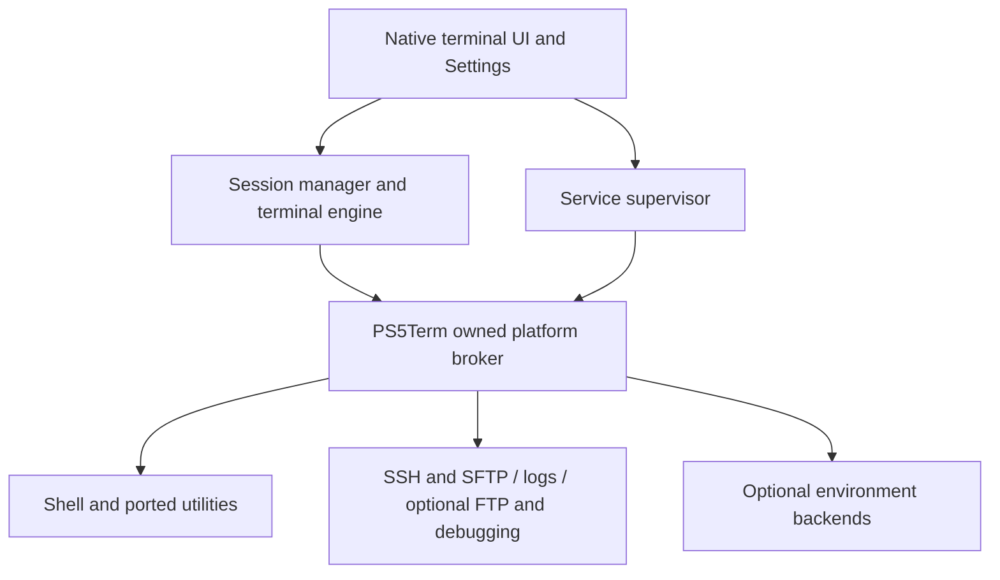

# PS5 tools and standalone integration

> Historical research snapshot, not a current feature or deployment guide.
> Start with [development scope](../DEVELOPMENT_SCOPE.md) and
> [current feature access](../FEATURES.md); retain the dated evidence below.

Research snapshot: 2026-11-01. This is a source survey and proposed design, not a claim that these features are implemented. The other agent's terminal/input work is outside this change.

## Product requirement

After the required jailbreak is active, the user launches PS5Term. The terminal and its bundled tools start themselves. Settings start, stop and configure optional services. Normal operation must not require sending a second payload, opening another app, running ps5upload or starting a network ELF loader on port 9021.

Internal helper executables are fine: ordinary applications use multiple processes. PS5Term must package, launch, monitor and clean up those helpers itself. Merely including an upstream payload ELF while retaining its external loader requirement does not meet this requirement. The initial jailbreak remains a platform prerequisite; automatically reproducing the jailbreak is outside the terminal's scope.

## What zftpd provides

[zftpd](https://github.com/seregonwar/zftpd) is a C FTP server with an optional HTTP file interface. Its useful features include resumable uploads, queued file operations, transfer statistics and portable platform abstractions. It is a candidate for optional file sharing, not a terminal, shell or complete operating system. Upstream throughput claims are not measurements on our consoles.

The most valuable implementation detail inspected is its [filesystem transfer path](https://github.com/seregonwar/zftpd/blob/09a7494b246e2f9c5c3c359a22284a31f0e7af18/src/platform/fileio/sendfile.c): console mounts such as exFAT, nullfs and PFS are excluded from its safe `sendfile` path, with buffered transfer fallbacks. Native PS5Term file utilities should likewise test filesystem behavior rather than assuming every POSIX optimization is safe everywhere.

Its [architecture](https://github.com/seregonwar/zftpd/blob/09a7494b246e2f9c5c3c359a22284a31f0e7af18/docs/architecture.md) separates protocols, transfers, event loops and platform code. That is a useful integration seam: reuse selected modules behind PS5Term adapters instead of embedding application entry points throughout our UI. Its [rest-mode documentation](https://github.com/seregonwar/zftpd/blob/09a7494b246e2f9c5c3c359a22284a31f0e7af18/docs/restmode.md) also distinguishes socket recovery from process survival. Our supervisor must handle both. A requirement to manually reinject a dead upstream process is unsuitable for PS5Term.

Prefer SSH/SFTP as the main authenticated remote-access and file-transfer experience. FTP can be an optional compatibility service. zftpd's optional custom encrypted extension should not be presented as standard SFTP or FTPS.

## Relevant ecosystem survey

This covers tools relevant to a terminal and research workstation; it is not an inventory of every PS5 payload. Features below describe upstream projects, not locally verified PS5 behavior.

| Project | Useful capability or lesson | Proposed PS5Term treatment |
| --- | --- | --- |
| [zftpd](https://github.com/seregonwar/zftpd) | FTP/HTTP transfers and console filesystem handling | Evaluate source modules for one optional transfer service; prioritize safe file I/O lessons. |
| [ftpsrv](https://github.com/ps5-payload-dev/ftpsrv) | Smaller FTP implementation | Compare complexity and maintenance with zftpd; choose one backend rather than running duplicate FTP servers. |
| [websrv](https://github.com/ps5-payload-dev/websrv) | Browser files interface, discovery and homebrew launching | Study service composition and discovery; keep remote administration optional. |
| [klogsrv](https://github.com/ps5-payload-dev/klogsrv) | Streams `/dev/klog` over TCP | Build an app log viewer around an owned reader; optional remote streaming should not require a second payload. |
| [gdbsrv](https://github.com/ps5-payload-dev/gdbsrv) | GDB remote debugging | Possible opt-in developer service after process/privilege compatibility is established. |
| [elfldr](https://github.com/ps5-payload-dev/elfldr) | Creates separate payload processes; bootstrap and process setup | Investigate source-level launch primitives. Owning this bootstrap is essential to removing external port 9021. |
| [ps5upload](https://github.com/phantomptr/ps5upload) | File deployment, app/process management and development workflow | Keep as a development tool; learn from its lifecycle/status APIs. End users should not need it to use PS5Term. |
| [Chiral FTP](https://github.com/Herbrax/Chiral-FTP) | Native controller-oriented file manager, saved connections and transfer UI | Study TV navigation and file workflow. Its documented external-loader elevation is not proof of standalone launch. |
| [BFpilot](https://github.com/ItsBlurf/BFpilot) | Browser file manager, archives, SMB and operation queues | Study reusable file-operation and archive adapters; avoid making a browser mandatory for terminal use. |
| [ps5debug-NG](https://github.com/Pharaoh2k/ps5debug-NG) | Process/maps inspection and debugging | Optional later research backend. It runs inside SceShellCore; that architecture needs separate justification, not automatic inclusion in every terminal launch. |
| [Lapy JB daemon fork](https://github.com/mpereiraesaa/PS5-Lapy-JB-Daemon) | Privilege/context lifecycle and owned credential/root references | Study ownership and cleanup. Firmware-sensitive assumptions and 13.60 behavior require independent evidence; no blind transplant. |
| [nanoDNS](https://github.com/drakmor/nanoDNS) | Configurable DNS forwarding and query logs | Possible later optional networking tool; no automatic system DNS changes. |
| [PS5 Linux loader](https://github.com/ps5-linux/ps5-linux-loader) | Booting a separate native Linux system | Separate research track. Replacing the running PS5 OS is different from an environment inside PS5Term. |
| [PacBrew](https://github.com/PacBrew) | Existing console library/tool ports and dependency builds | Reuse compatible recipes and patches; verify each package's ABI and runtime assumptions. |
| [ProsperoStore](https://github.com/darkxex/ProsperoStore) and [native app boilerplate](https://github.com/drakmor/ps5-native-app-boilerplate) | Packaging, assets and native app conventions | Keep app distribution and startup consistent with the store; packaging alone does not supply missing runtime privileges. |

ps5debug-NG currently lists 13.60 support upstream; BFpilot lists testing on 11.60. Neither statement substitutes for a test on the user's fat 13.60 console. A homebrew application context can also differ from an externally launched payload context even on the same firmware.

## Proposed integration boundary

The broker is an architectural role, not a chosen injection technique. It may initially be an app-owned helper process. Its launch, credential acquisition, process creation, PTY access and shutdown must be proven from the native app context. A local IPC interface should expose explicit operations rather than making the UI know kernel offsets or upstream payload wire protocols.

Services should implement start, stop, status, configure and health reporting. Settings must distinguish desired state from confirmed listening state. On shutdown, stop listeners and owned sessions; on resume, check process and socket health before reconnecting. Detect port conflicts without terminating unrelated services. Preserve passwords, host keys, logs, package manifests and environment state under PS5Term-owned paths such as `/data/ps5term`; do not silently take ownership of another app's directory.

Core acceptance test: with the jailbreak already active and no external loader running, launch PS5Term, execute a bundled command, enable SSH in Settings, authenticate, stop SSH, then relaunch and resume. Record exact firmware/model, identities, available filesystem access and owned processes. Existing code's external 9021 dependency remains an implementation gap until this passes on hardware.

## Reuse and attribution

Source inspection is separate from vendoring. Research snapshots were inspected at a recorded commit with a license identifier. zftpd was inspected at `09a7494b246e2f9c5c3c359a22284a31f0e7af18` (MIT). ftpsrv, websrv, klogsrv, gdbsrv and Chiral identify GPL-3.0 licenses; BFpilot identifies MIT. The inspected Lapy fork's GitHub license metadata is inconclusive, so inspect its actual notices before selecting code.

For every imported component, record its original URL, exact revision, copyright notices, license text, local patches, dependency licenses and build recipe. Preserve existing credits even if we rewrite interfaces and storage paths. Attribution alone is not a substitute for the license's requirements; select compatible components and provide the required source/materials with distribution. No third-party implementation was added to the product by this research change.

## Implementation order

1. Prove app-owned launch and PTY/process lifecycle without an external loader. This is the largest standalone uncertainty.
2. Complete terminal behavior and a small native package set. Keep input work with its current owner.
3. Integrate SSH/SFTP and logs with a common supervisor and durable Settings.
4. Add file sharing and selected developer services as optional modules.
5. Prototype environment images after native capability probes. A jail shares the PS5 kernel; a Linux guest supplies its own. Neither should block the terminal foundation.
