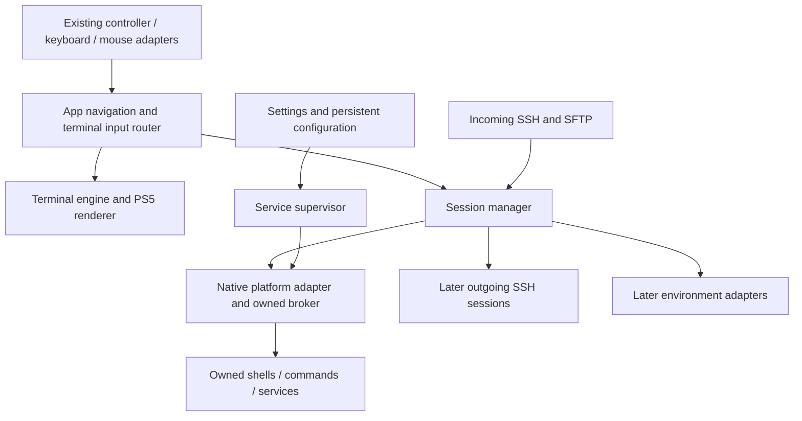

# PS5Term product and architecture design

Status: consolidated design for implementation, 2026-11-01. Supersedes conflicting proposals in the earlier research notes; historical evidence remains historical. This specifies decisions, milestones and investigation gates. It does not claim unresolved platform capabilities are available.

## 1. Product contract and priorities

PS5Term is a native terminal for jailbroken PS5 systems. It must be useful with a controller alone, a keyboard alone, or keyboard and mouse. Preserve the existing input work and put new terminal behavior behind its event boundary.

After the required jailbreak and native homebrew loader are active, the user launches one app. Normal operation must not require an external elfldr on port 9021, a separately installed ps5sshd, ps5upload, or manual payload sending. Bundled internal helper processes are allowed; PS5Term owns their launch, health, shutdown and version compatibility. ps5upload is a development/test dependency only.

Priorities: correct terminal and session behavior; standalone native tools; integrated SSH/SFTP and durable Settings; reproducible package growth; optional complete guest environments. Native jails and guest VMs are independent investigations, not prerequisites for the terminal. Neither a package prefix nor a jail supplies a new kernel.

Broad jailbroken-firmware compatibility is a design goal. Hardware development is restricted to **phat 192.168.86.99, firmware 13.60**. **Do not contact or modify the Pro at 192.168.86.100.** No discovery or default-address fallback in test tooling. Other firmware/model support remains unverified until there is evidence.

## 2. Architecture and ownership

Separate portable terminal/session/service state from PS5 ABI and privileged operations. The broker is a responsibility boundary; its execution context is selected by the first platform milestone. Do not choose a shell-process injection strategy solely because another payload uses it. Credentials are established before worker threads; ownership and kernel-object references must follow the selected mechanism's lifetime rules.

Session identity is an opaque generation-tagged ID, never a bare PID. A session exposes byte input/output, EOF, exit status, lifecycle, dimensions and capabilities. Capabilities distinguish raw input, real PTY, resize, process-group signaling and a line-oriented fallback. A session has one input owner initially; attaching multiple viewers must not accidentally create multiple writers.

Native frontend and incoming SSH share the session backend and shell selection. Each incoming SSH login gets its own session, not the visible local session. SFTP uses its own filesystem adapter. Guest and remote sessions may implement more capabilities than native sessions. Names and UI labels identify host versus guest and their identities explicitly.

## 3. Standalone launch and native capability gate

First measure the native app context and a PS5Term-owned child: real/effective IDs, platform context where available, filesystem access, descriptor types, process creation/wait/exec, pipes, PTYs/termios, signals/groups, polling and resource limits. Short-lived probes clean up everything they create. SDK declarations and dump symbols do not count as runtime success.

Evaluate native launch APIs first, then reusable loader primitives behind a PS5-specific adapter. Existing SDK kernel helpers must be audited for firmware coverage and error reporting. Keep offset/layout assumptions out of generic UI/service code. No uncontrolled retries, unrelated donor-process changes or automatic system-UI injection.

Gate A passes only when a native title can launch an owned helper, exchange data and reap/stop it with no external 9021 listener. If native app privileges or loader mechanics prevent that, record the exact failure and keep the broker experiment separate from the working app. Do not relabel the existing external-loader path as standalone. A development-only compatibility mode can remain explicitly labeled, but cannot satisfy release acceptance.

Gate B establishes the terminal model. A real PTY must pass terminal-mode, controlling-terminal, resize and signal/group tests; allocation alone is insufficient. If unavailable, retain an honest line-command backend while investigating an adapted runtime. Userspace echo/editing over pipes does not promise arbitrary POSIX TTY programs. Complete interactive native-shell support stays blocked until a viable terminal/process model is demonstrated; this does not block a richer VT frontend or SSH/SFTP file access.

## 4. Terminal engine, rendering and interaction

Use **libvterm 0.3.3** as the initial VT engine, isolated behind `TerminalModel`; it is a C99 callback-based engine without a mandatory GUI toolkit. Pin the official source archive and its verified digest in a dependency lock before importing it. Confirm compile/runtime prerequisites against the native runtime shim. A failed port returns to a focused engine evaluation, not a complete terminal rewrite. [Upstream](https://www.leonerd.org.uk/code/libvterm/)

The PS5 renderer consumes cells, attributes, cursor and damage ranges. UTF-8 input and terminal cell semantics are distinct from glyph coverage. Add a redistributable font/rasterizer with a license manifest, glyph fallback, combining/wide-character handling and font-size-driven rows/columns. Do not claim universal language shaping until tested. Selection uses stable logical text positions across scrollback eviction and resize; alternate-screen applications have separate behavior.

Provide colors, cursor movement, alternate screen, terminal queries, bracketed paste, search, selection/copy/paste, scrollback, session tabs and profiles. Add panes after session lifecycle is stable. Enable application mouse reporting only when requested, with an app selection override. Advertise a TERM value backed by tested capabilities and available terminfo; avoid advertising extensions without implementation.

Command-line mode retains the current editable line/history and explicit Run action. Raw terminal mode sends key/control sequences directly to the program. R2 submits a line only in command-line mode; in raw mode it opens the action palette. Triangle toggles the controller palette/keyboard; Circle closes overlays first. L2+Circle is the explicit interrupt action where supported. Controller palette exposes Escape, Tab, arrows, Ctrl/Alt chords, EOF, function keys, paste and session switching. Settings retains Options/F6 initially, with an explicit send-key action for applications that need F6.

Mouse is optional. Keyboard-only users can reach every app action. Input hotplug preserves session and typed input. Multiline paste in command mode requires review; raw mode honors bracketed paste when enabled and clearly identifies immediate input delivery. App clipboard remains distinct from a host computer's clipboard. Input changes must be coordinated with the input implementation owner.

Initial resource bounds: four local sessions, scrollback bounded by both 10,000 lines and 8 MiB per session, 256 KiB pending input/output queues per direction, 16 KiB I/O chunks and at most 64 KiB received per session per UI tick. Bound work across sessions too; network/disk/crypto initialization must not block rendering. Benchmark memory, TV readability and input latency on phat before raising limits. Backpressure stops reading; do not silently discard command bytes. Defaults may be lowered when measured app limits require it, with recorded rationale.

## 5. PS5Term SSH/SFTP service

Build a project-owned service layer around the existing pinned **wolfSSH/wolfCrypt** dependencies, retaining ps5sshd code only where useful and attributed. Own configuration, session adapters and lifecycle. Do not rewrite SSH cryptography. Review dependency fixes/advisories and license obligations before distribution. [wolfSSH capabilities](https://www.wolfssl.com/products/wolfssh/)

Service state: disabled, starting, listening, stopping or failed. Desired preference and confirmed runtime state are separate. Start/stop are idempotent. Verify service identity/version and authenticated health, not merely an open TCP port. A stale generation cannot mark a replacement listener ready. Port conflicts show an actionable persistent error and never terminate unrelated servers.

Defaults: SSH off on a fresh install, port 22, configurable port 1–65535; offer 2222 explicitly on conflict rather than silently choosing it. Existing saved enabled preference is preserved during migration. Settings shows listening address, actual port, username, authentication method, host-key fingerprint and copyable SSH/SFTP commands. Service username maps to a documented PS5 identity; no claim of ordinary multiuser Unix accounts. Effective UID and platform capability evidence remain separately visible in diagnostics.

Support authorized keys and a generated per-install password. Keep initial password in an owner-only file for controller-accessible reveal; reveal hides on Settings exit. Allow password replacement/regeneration and key management; do not log credentials. The retained recoverable password is an explicit usability tradeoff until an equivalent controller-friendly credential provisioning flow replaces it. Host keys persist across app updates; changing a password does not regenerate host keys. Do not ship universal passwords or private keys in packages. Failed-auth throttling is bounded and does not block established sessions.

SFTP must handle partial I/O, large files, symlinks, disconnects and filesystem-specific restrictions. Use a worker boundary for potentially blocking disk operations. Test actual native filesystem semantics; do not assume `sendfile` is safe on every PS5 mount. Remote `exec` keeps stdout/stderr/exit status distinct. Unsupported PTY, resize or forwarding requests receive truthful protocol responses. Port forwarding is off initially and can follow as a separately tested feature.

Turning SSH off closes its listener and server-owned sessions, but leaves local terminal sessions alone. Normal app close stops owned services/children; persistent background operation is not a first-release feature. On forced app death, the broker's authenticated lease expires within 10 seconds and closes services. Resume revalidates IPC, listener and child identities. If the selected process mechanism cannot enforce that lifecycle, release remains gated; a settings flag alone is not sufficient.

## 6. IPC, storage and migration

Prefer inherited pipes/socketpairs when the selected app/helper contexts can share descriptors. If they cannot, use loopback sockets with per-launch authentication, explicit protocol version, generation and owner identity. Do not mistake SceNet descriptors for kernel descriptors. IPC frames are length-delimited and bounded at 64 KiB; reject unsupported versions and malformed lengths before allocation. Bootstrap secrets travel through an inherited descriptor where possible, otherwise an owner-only temporary file removed after handshake; never package a static token. Logs redact tokens/passwords.

Use app assets under read-only `/app0`; writable state under `/data/ps5term/{config,ssh,bin,lib,packages,logs,research,environments}` when access is verified. Unprivileged UI preferences may use title-local `/download0` with sufficient declared storage; no silent redirection of privileged keys or tools. Report unavailable storage explicitly.

Configuration is versioned, bounded and written with temporary-file/fsync/rename semantics. Preserve the old valid file on interrupted updates. SSH directory mode 0700 and secret files 0600; log rotation is bounded. Diagnostics store capabilities and errors without dumping credentials or arbitrary process memory.

Existing `/data/ps5sshd` belongs to another installation. Do not move, delete or overwrite it. Offer explicit one-time import into the PS5Term prefix, preserving host keys when selected to avoid needless client identity changes; report conflicts. Existing PS5Term enable/speed settings migrate automatically within its own directory. First-run migration never auto-enables a network service lacking valid credentials. Package upgrades preserve writable data and support rollback of the previous app version.

## 7. Native packages and environments

First publish a manifest for the existing core tools, with source revisions, licenses and capability requirements. Prioritize a real shell, text tools, archives, curl/TLS, an editor and scripting runtime as separate ports after ABI tests. Use FreeBSD sh as the first complete-shell candidate if process/TTY APIs permit; otherwise retain the limited backend and report the missing operations. BusyBox is a later measured port candidate, not the default way to obtain an OS.

Package records include version, target/ABI profile, dependency closure, artifact digest, source/license/build recipe, installed files and required capabilities. Use a staged prefix and atomic activation/rollback; refuse archive path traversal, escaping symlinks and unmanaged-file overwrite. No fetching arbitrary unsigned online package feeds in the first milestone. Build-time PacBrew imports and runtime package installation remain separate systems.

Environment backends expose create/start/status/open-session/stop/delete, storage usage and export/import. Native jail support requires real syscall/mount/credential/network evidence. A jail remains a Sony-kernel environment. A complete Linux/FreeBSD OS requires a guest kernel. Prototype QEMU software emulation first with serial, then persistent storage, then networking; measure actual PS5 usability before a Settings toggle. No hardware-acceleration promise. Guest disks remain private, with verified images, size/resource limits and explicit host-sharing permissions. Direct Linux boot is a separate product path.

## 8. Firmware and offline research

Maintain per-feature capability records containing firmware, model, process context, relevant library/build IDs, adapter version, probe result, errno/error and evidence identity. States: unknown, source-supported, reference-tested, hardware-tested, unsupported. Never infer support for adjacent firmware or Pro from phat success. Unsupported optional features disable gracefully; unsafe unknown privilege layouts reject cleanly.

Keep firmware offsets/layouts inside reviewed versioned profiles; verify expected runtime structures before using them. Detect capabilities where safe rather than requiring a new whole-app build per firmware. Ordinary UI should not require hypervisor defeat; deeper research actions can declare additional prerequisites individually.

Use existing private kernel/libkernel captures to map loader, syscall, PTY and jail paths. Reconcile capture model/base/patch state before interpreting addresses. Collect fresh targeted evidence only for a named unresolved question and only from the phat during this development. Dump analysis is not a faithful QEMU PS5 emulator. Reference VMs validate portable behavior and builds, not Sony-kernel capabilities.

## 9. Development and hardware test loop

Use ps5upload for phat-only process inspection, app close, file transfer, readback verification, screenshots/logs and available controller/keyboard/mouse test input. Every request carries explicit `addr=192.168.86.99`; no console-wide defaults. Lock the test window so the input agent and this work do not mutate the app simultaneously. Preserve the last known good folder and manifest. Do not commit/push the uncommitted repository without user instruction.

Harness sequence: preflight engine/version/selected helper and phat identity; build/test candidate; record source/build ID and every file digest; request app close and verify title exit; stop only positively identified owned helpers; transfer candidate; verify exact file list and full remote hashes; launch once; confirm new app instance, expected build ID, readiness and foreground focus; run targeted checks; collect redacted evidence; close/reopen and verify persistence/cleanup. A successful transfer, accepted launch request or open port alone is not a pass. Remove obsolete package files using the previous app manifest only; never sweep shared `/data`.

**Launch gap:** `docs/HANDOFF.md` forbids the current engine launch path because it can restart ShellUI. The inspected ps5upload launcher still has a ShellUI ptrace fallback, and `/api/ps5/app/launch` has no no-fallback option. Do not call that route blindly. Implement the harness with a launch adapter: prefer ps5upload Remote Play controller navigation from observed home-screen state; verify that route and input availability first. Alternatively coordinate a ps5upload no-fallback launch API as a separate change, not an assumed capability. Until a safe route passes, use the known no-launch deployment script and user home-screen launch, and mark automated relaunch blocked. This is a tracked gate, not permission to drop reopen testing.

Host suites test terminal transcripts, session/supervisor failures, configuration, IPC bounds, package validation and target restrictions without a console. Wire the separate terminal suite into `make test`/`make check`, fix host portability, and add CI configuration. Until CI can run from this uncommitted checkout, the documented Linux build container is a local reference check, clearly labeled. Do not rebuild shared outputs while the other agent is using them; use a coordinated build window or isolated temporary snapshot excluding private data.

Hardware checks include controller-only and keyboard-only flows, optional mouse, hotplug, floods/partial writes, wrong SSH credentials, SFTP roundtrip, host-key persistence, port conflict, toggle-off with a held session, repeated relaunch, crash recovery and resume. Rest-mode tests follow basic lifecycle success and require an exclusive test window. No reboot, new jailbreak payload or kernel mutation is an automatic recovery step. On console instability, stop the test, preserve logs and return to the known good app without touching the Pro.

## 10. Milestones and release gates

| Milestone | Deliverable | Required evidence |
| --- | --- | --- |
| M0 | Reliable phat-only test/deploy/reopen harness and baseline | Target guard, hashes, app instance/build identity, safe launch route or explicit blocked gate |
| M1 | Capability report and standalone owned helper | No external 9021; start/data/exit/forced-close cleanup from native title |
| M2 | VT engine and shared session boundary | Transcript tests, Unicode cell/rendering tests, controller/raw-mode contracts; truthful native capability labels |
| M3 | PS5Term-owned SSH/SFTP | Auth, exec/status, transfer, config/keys, stop/reopen/crash/resume tests; no `/data/ps5sshd` dependency |
| M4 | Native tool/package baseline and richer sessions | Consistent local/SSH behavior, dependency manifests, update/rollback; editor/full-screen proof if claiming it |
| M5 | Optional environments | Separate jail/VM evidence and practical resource results before enabling UI |

A standalone release requires M0–M3, correct support labels and passing relevant phat tests. A full interactive-terminal claim additionally requires the native PTY/process contract and a working interactive shell/program. ProsperoStore publication requires corresponding source, dependency notices, digest/versioned artifact and honest firmware compatibility metadata. Publication is separate from this design work.

Open platform questions are assigned to gates A/B, the launch gate and M5. No unknown has been converted into an implementation promise. Earlier research details remain in `docs/research/`; this spec is the product decision source.
